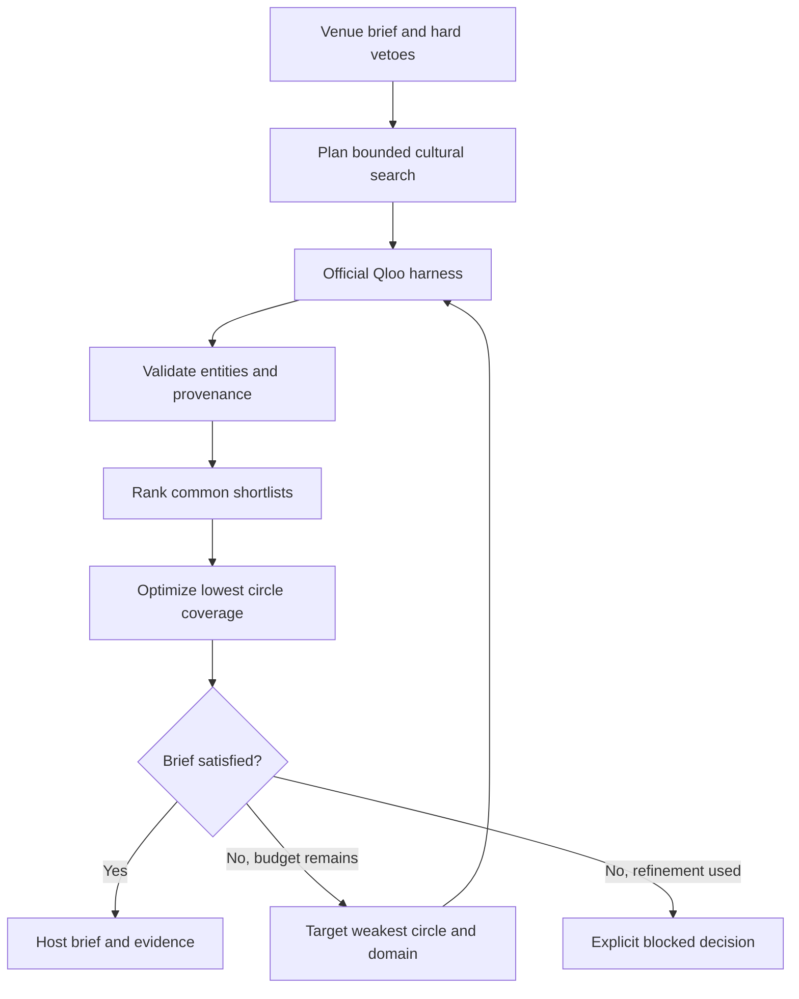

# Product and technical specification

Version 0.1.0. Prepared October 21, 2026. Implementation behavior is defined by this repo; official external contracts are linked in [HARNESS_CONTRACT.md](HARNESS_CONTRACT.md).

## User and job

The user is an independent venue owner choosing one cultural conversation event. The owner supplies two or three taste circles, each described by one to three public works or creators. A circle is an explicit planning input, not a demographic segment inferred from a person. The app does not import account histories or private audience records.

The job ends when the owner has either a complete 60, 90, or 120 minute host brief that satisfies the chosen relative-coverage threshold and all vetoes, or a specific explanation of why no such brief was found within the bounded search.

## Inputs and boundaries

| Input | Constraint | Purpose |
| --- | --- | --- |
| Venue | 1 to 80 characters | Names the host brief; no venue lookup is implied |
| Taste circles | 2 or 3, with distinct labels | Defines whose cultural interests must receive evidence |
| Anchors | 1 to 3 public names or real Qloo UUIDs per circle | Drives graph resolution and discovery |
| Vetoes | Up to 30 exact names or IDs | Excludes a specific cultural entity, case-insensitively |
| Minimum coverage | Integer 0 to 100 | Sets an application-relative comparison threshold |
| Duration | 60, 90, or 120 minutes | Makes the host schedule executable |

The three domains are fixed: `book`, `artist`, and `movie`. The result is a conversation salon, not a confirmed screening or concert booking. The app does not know licensing, performer availability, venue inventory, cost, venue accessibility, or attendee intent.

Vetoes are exact entity exclusions. A phrase such as “nothing sad” is not a semantic veto and must not be presented as one. There is no silent rewriting of a user's constraints.

## Agent architecture



The loop is implemented in `src/agent.js`. The planner is deterministic and goal-directed. It is not an LLM agent, a multi-agent system, or a fixed collection of suggestions. Its next discovery call depends on the observed weakness of its first result. Its termination depends on the explicit goal, evidence adequacy, hard constraints, and bounded budget.

### Initial search

For each domain and each circle, call the official `recommend` workflow with the circle's anchors and a limit of three. The live harness resolves named entities and calls Qloo Insights. The app unions returned entity IDs, removes explicit vetoes, and keeps at most ten eligible candidates per domain.

For each circle and domain, call `rank` with the same candidate IDs. This prevents a misleading comparison in which each audience's “first choice” came from a completely different candidate set. Input and output IDs are retained in the workflow evidence record.

The three-circle case uses nine discovery and nine ranking workflows before refinement. Empty domains skip useless ranking calls.

### Evaluation

Enumerate every combination of one eligible book, one artist, and one film. At the maximum ten candidates per domain, there are 1,000 combinations, small enough for transparent exhaustive search. For each combination, calculate per-circle coverage and optimize the minimum. Break ties using the mean, then a stable entity-ID order.

Require at least three eligible comparison candidates in each domain. A lone returned item being rank one is not enough to justify a convincing relative-coverage claim.

### Adaptive refinement

If the brief fails its threshold, is missing a domain, or has too few comparison candidates, select one follow-up search. Prefer a sparse domain; otherwise choose the lowest-scoring slot for the currently weakest circle. Request up to six candidates for that circle and domain. If new eligible IDs arrive, rerank that changed domain for every circle. Re-optimize once.

The planner performs at most one such refinement. The complete maximum is 15 workflows for two circles and 22 for three: six initial workflows per circle, then one deeper discovery and one revised-domain comparison per circle. The server reserves that same complete maximum before constructing the adapter. If no new eligible entity is found, it avoids the redundant rerank. A budget shortfall raises a visible error instead of pretending a partial result is complete.

### Completion or refusal

When the threshold and evidence-adequacy checks pass, return `status: ready`, the chosen bundle, a timed schedule, host prompts, a counterfactual baseline, and traceable evidence. Otherwise return `status: blocked`, a reason, and optionally the best unqualified candidate for diagnosis. A blocked result has no approved selection and no host program.

Authentication, schema, provenance, ambiguity, quota, and transport failures return errors. They are different from a successful graph query whose results cannot satisfy a brief.

## Score contract

For a shortlist of size `N` and a returned candidate at rank `r`, the application score is:

```text
relative score = 100 * (N - r + 1) / N
circle coverage = mean(relative scores for book, artist, movie)
primary objective = maximum possible minimum circle coverage
secondary objective = maximum possible mean circle coverage
```

The code rounds displayed intermediate scores and metrics to two decimal places. Ranking uses the returned order of the pinned `rank` workflow. Raw Qloo affinity is kept separately as `rawAffinity`; it is not rescaled into a probability.

A candidate omitted from a circle's rank response gets a conservative score of zero, `observed: false`, and an explicit evidence-gap note. Its record points to the actual ranking request that included the candidate, making the omission inspectable. It is never described as something that circle dislikes.

The average-only counterfactual maximizes mean coverage and then minimum coverage on the identical final shortlist, with the identical vetoes. A within-run comparison isolates the objective. A score from the initial search cannot be interpreted as a calibrated improvement or decline after the shortlist changes during refinement.

## Data model and provenance

Every successful run returns:

- A run ID, evidence mode, timestamp, duration, validated input, and final status.
- A candidate catalog containing actual normalized IDs, names, domains, discovery workflow references, and per-circle scores.
- A workflow evidence list with operation, circle, domain, anchor inputs, candidate option IDs, normalized results, and provenance.
- A trace of plan, tool, observed-result, constraint, evaluation, refinement, and completion or blocked steps.
- A completed program only when feasible, plus the final-baseline comparison and limits.

The live provenance includes the source, Insights endpoint, pinned harness/schema versions, retrieval time, request count present in the returned provenance, and a digest of that provenance. It does not claim to capture the harness's entire HTTP request history. Entity-resolution requests and internal retries can make actual API usage higher.

Raw source descriptions, HTML, and unbounded metadata are not accepted into the planning model. Cultural names remain text. The UI constructs DOM nodes with `textContent` and never turns provider text into instructions or markup.

## Adapter contract

`FixtureAdapter` returns invented relationships from `fixtures/scenario.json` and makes zero network requests. It only accepts the displayed sample anchors. Edited fixture anchors are rejected because they have no matching synthetic evidence.

`QlooHarnessAdapter` starts an explicitly pinned executable without a shell. JSON is sent on stdin. It uses an allowlisted environment, an explicit event API key, the official Qloo API host, native resolution, and a project-private Qloo state directory. It validates all returned identities and result provenance before the optimizer sees them.

The adapter refuses mismatched versions, unsupported result statuses, malformed entities, duplicate or unrequested IDs, wrong domains, nonnumeric affinities, and missing Insights provenance. It refuses ambiguous resolution and never substitutes a fixture. Exact details and source locations are in [HARNESS_CONTRACT.md](HARNESS_CONTRACT.md).

## HTTP API

| Endpoint | Behavior |
| --- | --- |
| `GET /api/health` | Server availability, project name, and configured mode; explicitly does not verify Qloo |
| `GET /api/config` | Safe sample inputs, mode, harness pin, and whether private development requires a code |
| `POST /api/plan` | Validated JSON input and one complete JSON result or error |
| `POST /api/plan/stream` | NDJSON trace records followed by exactly one final result, or an error record |

Stream records use `{ "type": "trace", "data": ... }`, `{ "type": "result", "data": ... }`, or `{ "type": "error", "error": ... }`. A stream may already have HTTP 200 headers when a later tool failure occurs, so consumers must inspect the terminal record. The browser implements this behavior.

The server caps request bodies at 16 KB, checks request origin for browser POSTs, serves only allowlisted static files, and sends a restrictive content-security policy. No server credential appears in `/api/config`, `/api/health`, result exports, or public errors.

## Quota and public availability

The public submission path requires no login or access code. `PUBLIC_DEMO=true` makes that intent explicit, and startup rejects a simultaneous `APP_ACCESS_CODE`. A private code gate remains available for development.

Only one live plan runs at a time. Per-IP limits cap plan submissions, and a shared persisted ledger caps workflows per hour. Each reservation is saved before its subprocess starts. A corrupt or unwritable ledger pauses live queries. Before starting a new plan, the server checks that the full configured per-plan allowance remains available.

The local file ledger is designed for one process and one replica with persistent storage. The Vercel entrypoint uses a private Blob coordinator with uncached reads, ETag conditional writes and one shared lease across all deployments. It reserves a full bounded plan before provider access. Only a confirmed complete planner outcome reconciles unused reservation slots; failures and uncertain outcomes retain the full reservation. Do not run quota-consuming CLI scripts against an independent ledger while the hosted app is active. See DEPLOYMENT.md for configuration and operational limits.

The pinned harness has its own bounded HTTP retries; Common Room does not add workflow retries. The subprocess limit defaults to 25 seconds and combined output is capped at one megabyte. Qloo quota ownership and API availability remain external dependencies. Current event documentation did not publish a universal numeric rate allowance for this credential.

## Deliberately absent features

No LLM, personal profiling, sensitive-trait inference, account-history import, contact collection, geolocation history, event publishing, booking, payments, ticketing, or claimed logistics validation is implemented. These boundaries keep the artifact honest and the core decision reviewable.
